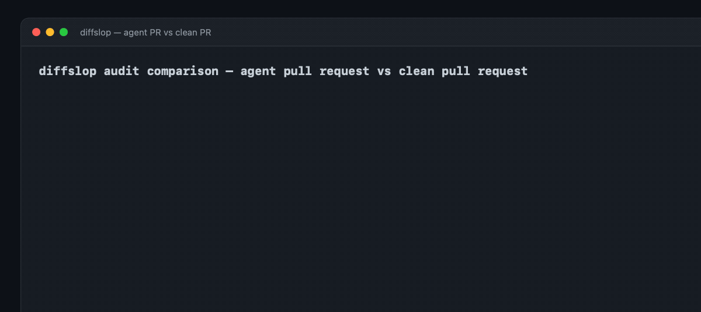

# diffslop

**Catch AI agent slop, weakened tests, and ghost code in your git diff before your human reviewers have to.**

[](https://github.com/AdilSiddiquiHQ/diffslop/actions/workflows/ci.yml)
[](./LICENSE)
[](https://nodejs.org)
[](#zero-runtime-dependencies)
[](https://github.com/AdilSiddiquiHQ/diffslop/stargazers)
[](https://github.com/AdilSiddiquiHQ/diffslop/commits)
[](#what-it-does-not-do)
[](./CONTRIBUTING.md)


`diffslop` audits the lines added in your git diff, detects AI agent degeneracies, calculates a deterministic **Slop Index**, and gates pull requests before they burn human review bandwidth.

Zero dependencies. Zero LLM calls at runtime. Under 25 milliseconds.

```bash
npx diffslop --since origin/main
```

---

## The problem: The Code Review Tax

Autonomous coding agents (Claude Code, Cursor, Copilot Agent, Aider, Windsurf) make it effortless to generate 400 lines of code across 6 files in 30 seconds. The test suite passes. The pull request is opened.

Then the human reviewer opens the diff.

The code compiles and runs, but the diff is poisoned with systemic shortcuts that traditional linters (like ESLint or Ruff) miss entirely:

- **Tautological assertions**: `expect(true).toBe(true)` or `assert(res !== null)` added to fake green test suites without testing behavior.
- **Swallowed errors**: `try { ... } catch (e) {}` or `.catch(() => {})` quietly added to bury exceptions that would otherwise crash tests.
- **AI conversational residue**: `// Note: This was updated to avoid recursion error` or `// Generated by Claude` left in production logic.
- **Type escapes**: `as any`, `@ts-ignore`, and `eslint-disable` sprinkled across the diff to silence compiler diagnostics.
- **Ghost declarations**: Helper functions or variables drafted during multi-step reasoning that are never exported and never referenced anywhere in the file.
- **Production mock fallbacks**: `if (process.env.NODE_ENV === 'test') return { orderId: 'mock-123' };` inlined into real backend services.
- **Workstation leaks**: Hardcoded absolute paths (`/Users/developer/...`) and exposed credential tokens.

This dynamic has created the **Code Review Tax**: developers spend more cognitive energy filtering agent slop than it would have taken to write the feature from scratch.

- [The Code Review Tax of AI Coding Agents](https://www.infoq.com/news/2026/02/ai-code-review-tax/)
- [AI Generated Tests Are Passing And Still Lying To You](https://dev.to/thebitforge/ai-generated-tests-are-passing-and-still-lying-to-you-46fm)
- [How to Stop Letting AI Agents Fake Their Own Tests](https://www.freecodecamp.org/news/how-to-stop-letting-ai-agents-fake-their-own-tests/)
- [Are Coding Agents Generating Over-Mocked Tests?](https://arxiv.org/html/2602.00409v1) (arXiv)

## What it does

```
your git diff  ->  parse added lines (+hunks)  ->  run 8 deterministic rules
               ->  calculate penalty points    ->  compute Slop Index (%)
```

`diffslop` inspects `git diff -U0 <base>` (or staged changes, or all files) and evaluates every added line against 8 strict detector rules.

```bash
npx diffslop                      # audit diff against origin/main
npx diffslop --staged             # pre-commit gate on staged changes
npx diffslop --fail-on-slop       # exit with code 1 if any slop is detected
npx diffslop --max-index 10       # allow up to 10% slop index
npx diffslop --json | jq .slopIndex
```

## The 8 Slop Rules

| Rule ID | Severity | Weight | What it Catches |
|---|---|---|---|
| **`SLOP01_TAUTOLOGICAL_ASSERT`** | High | +3.0 | `assert(true)`, `expect(x).toBe(x)`, `expect(res).toBeDefined()` without value verification. |
| **`SLOP02_SWALLOWED_ERROR`** | High | +2.5 | Empty `catch {}`, `.catch(() => {})`, `except: pass`, or catch blocks that bury exceptions. |
| **`SLOP03_AI_CHAT_REMNANT`** | Medium | +2.0 | Conversational notes (`// Note: This was updated to avoid...`, `// Generated by...`, `// FIXME: mock`). |
| **`SLOP04_TYPE_ESCAPE_HATCH`** | Medium | +2.0 | `as any`, `as unknown as any`, `@ts-ignore`, `@ts-nocheck`, and unannotated linter suppressions. |
| **`SLOP05_GHOST_DECLARATION`** | Medium | +2.0 | Unexported functions, classes, or const helpers declared in the diff that are never referenced in the file. |
| **`SLOP06_PRODUCTION_MOCK_FALLBACK`** | Critical | +3.5 | Inlined test mode branches (`if (process.env.NODE_ENV === 'test') return ...`) in production code. |
| **`SLOP07_LOCAL_PATH_LEAK`** | Critical | +3.5 | Hardcoded `/Users/...` machine paths, local file URLs, or raw API secret keys committed to source. |
| **`SLOP08_COLLATERAL_DIFF_NOISE`** | Low | +1.0 | Gratuitous trailing spaces, blank line churn, and formatting noise with zero semantic change. |

## The metric: Slop Index

The **Slop Index** is a deterministic, measured score from 0% to 100%:

$$\text{Slop Index} = \min\left(100, \frac{\text{Total Slop Penalty Points}}{\text{Added Lines}} \times 100\right)$$

- **0% Slop Index**: Pristine diff. Ready for human code review.
- **1% – 25% Slop Index**: Minor slop. Contains formatting noise or minor escape hatches.
- **> 25% Slop Index**: Heavy agent slop. Contains tautological assertions, swallowed exceptions, or production mocks.

## The example, measured

The repository ships with real testable example pull requests in [`examples/shop-slop`](examples/shop-slop) and [`examples/shop-clean`](examples/shop-clean).

This is the real, measured output produced by `node scripts/demo.mjs` and verified byte-for-byte by the test suite:

### Agent Pull Request (`examples/shop-slop`)
```
  diffslop v0.1.1 — AI Agent Diff & Slop Auditor

  Slop Index: 34% [███████░░░░░░░░░░░░░] (HEAVY AGENT SLOP DETECTED (REJECT))
  Scanned 2 file(s), 56 added line(s), found 7 issue(s) on 7 line(s)

  src/checkout.js
    L3     MEDIUM    SLOP03_AI_CHAT_REMNANT
          snippet: // Note: This was updated to avoid recursion error in cart handling
    L8     CRITICAL  SLOP06_PRODUCTION_MOCK_FALLBACK
          snippet: if (process.env.NODE_ENV === 'test') return { orderId: 'mock-999', status: 'success' };
    L27    CRITICAL  SLOP07_LOCAL_PATH_LEAK
          snippet: const debugPath = '/Users/abdulaziz/workspace/cart-debug.log';

  test/checkout.test.js
    L10    HIGH      SLOP01_TAUTOLOGICAL_ASSERT
          snippet: assert(true);
    L13    HIGH      SLOP01_TAUTOLOGICAL_ASSERT
          snippet: assert.deepEqual(cart, cart);

  Total Slop Penalty: 19.0 pts across 56 added lines -> 34% Slop Index
```

### Clean Pull Request (`examples/shop-clean`)
```
  diffslop v0.1.1 — AI Agent Diff & Slop Auditor

  Slop Index: 0% [░░░░░░░░░░░░░░░░░░░░] (CLEAN DIFF (READY FOR REVIEW))
  Scanned 2 file(s), 92 added line(s), found 0 issue(s) on 0 line(s)

  ✔ No agent slop, weakened tests, or ghost declarations found.
```



## Comparison table

| Capability | `diffslop` | Traditional Linters (ESLint, Biome) | AI Code Review Bots |
|---|---|---|---|
| **Diff-scoped analysis** | **Yes (`git diff -U0`)** | No (scans whole files) | Yes |
| **Zero runtime dependencies** | **Yes (0 dependencies)** | No (hundreds of packages) | N/A (hosted SaaS) |
| **No network / LLM at runtime** | **Yes (100% offline)** | Yes | No (requires LLM API) |
| **Execution speed** | **< 25ms** | 1s – 10s | 15s – 60s |
| **Tautological assert detection** | **Yes (`SLOP01`)** | No | Hit-or-miss hallucination |
| **Ghost orphan detection** | **Yes (`SLOP05`)** | Partial (only if rule configured) | No |
| **Local machine path leak detection** | **Yes (`SLOP07`)** | No | No |
| **CI exit gate with numeric metric** | **Yes (`--fail-on-slop`)** | Binary pass/fail | Non-deterministic comments |

## GitHub Action

Add `diffslop` as a mandatory pull-request gate in `.github/workflows/diffslop.yml`:

```yaml
name: diffslop

on:
  pull_request:

jobs:
  gate:
    runs-on: ubuntu-latest
    steps:
      - uses: actions/checkout@v4
        with:
          fetch-depth: 0

      - uses: AdilSiddiquiHQ/diffslop@v0.1.1
        with:
          since: origin/main
          fail-on-slop: "true"
```

## Programmatic API

```javascript
import { auditGitDiff, auditRawDiff, formatReport } from 'diffslop';

// Audit git diff
const result = auditGitDiff({ since: 'origin/main' });
console.log(`Slop Index: ${result.slopIndex}%`);
console.log(`Penalty: ${result.totalPenalty} points`);

// Or audit a raw diff string
const customResult = auditRawDiff(rawUnifiedDiffText);
console.log(formatReport(customResult));
```

## Zero runtime dependencies

`diffslop` has **zero runtime dependencies** (`dependencies: {}`). It relies exclusively on the Node.js standard library (`node:fs`, `node:child_process`, `node:path`).

There are no network calls, no telemetry, no tracking, and no external API keys required.

## What it does not do

- **It does not rewrite your code for you.** `diffslop` is an objective measuring gate. You or your agent must clean the code.
- **It does not call an LLM to review your code.** Everything is calculated using deterministic lexical and syntactic patterns.
- **It does not require an account, token, or hosted server.** It runs locally in your terminal and on your CI runners.

## Honest limits

- **Diff scoping**: `diffslop` only analyzes added lines (`+` lines) and their containing file context. Deletions are not scored as slop.
- **Language support**: Syntax rules (`asserts`, `errors`, `types`, `mocks`, `ghosts`) are tuned for JavaScript, TypeScript, Python, and Go. Generic rules (`comments`, `leaks`, `noise`) work across all languages.
- **Ghost detection**: `SLOP05` uses lexical token tracking within the modified file. If an unexported function is dynamically evaluated via `eval()` or global reflection, it will still be flagged as unused.

## FAQ

#### Why check the diff instead of the whole file?
Because coding agents touch small parts of massive enterprise codebases. You don't want a PR blocked by legacy code written five years ago. `diffslop` measures exactly what you changed right now.

#### Can I use this in a pre-commit hook?
Yes:
```bash
npx diffslop --staged --fail-on-slop
```
If an agent or human staged code containing slop, git blocks the commit before it ever hits GitHub.

#### What if a test genuinely needs `expect(res).toBeDefined()`?
Hollow assertions are weighted at 1.5 points. If the rest of your test suite contains deep structural assertions, your Slop Index remains well under 5%. If 100% of your tests only check `toBeDefined()`, your suite is not testing behavior.

---

## Contributing

Pull requests are welcome! See [CONTRIBUTING.md](./CONTRIBUTING.md) for local setup, test execution, and guidelines.

## License

MIT © 2026 Adil Siddiqui
